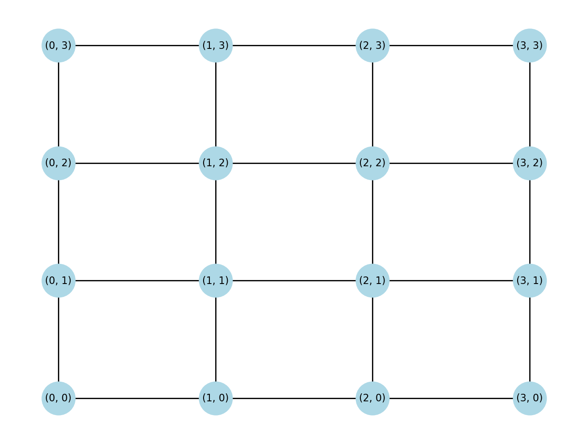
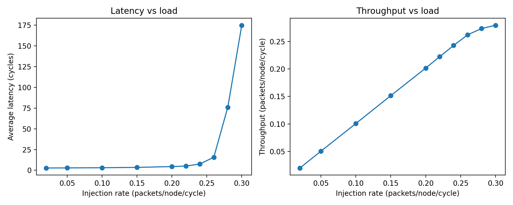
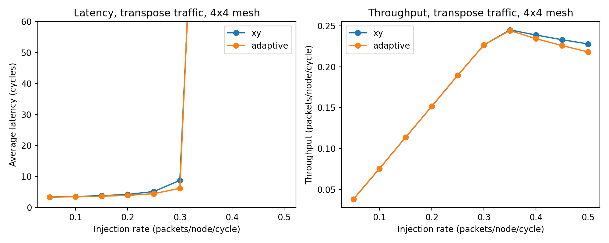

# noc-sim

A cycle-based **Network-on-Chip (NoC) simulator** in Python for studying routing algorithms on 2D mesh topologies.

## Features

- 2D mesh topology builder (NetworkX)
- Deterministic **XY routing** and congestion-aware **minimal adaptive routing**
- Packet-level, cycle-based simulation with per-router FIFO queues
- Traffic patterns: uniform random, transpose
- Metrics: average packet latency and throughput

## Quick start

```bash
git clone https://github.com/mitra-mottaghi/noc-sim.git
cd noc-sim
pip install -r requirements.txt
python3 -m src.simulator          # quick run
python3 -m src.compare_routing    # generate comparison plot
python3 -m pytest                 # run tests
```

## Results

**4x4 mesh topology**



**XY routing, uniform traffic: latency and throughput vs load**



Latency stays low at light load and rises sharply once the network saturates.

**XY vs adaptive, transpose traffic**



At an injection rate of 0.3, average latency is 8.79 cycles for XY and 6.20 cycles for adaptive routing (about 30% lower).

## Project structure

```
src/topology.py        mesh construction and drawing
src/routing.py         XY path and next-hop selection (xy / adaptive)
src/simulator.py       cycle-based simulator and traffic patterns
src/compare_routing.py XY vs adaptive comparison plot
tests/                 unit tests
```

## Simplifications

- Infinite router buffers, one packet forwarded per router per cycle
- Adaptive routing is minimal and does not model deadlock avoidance

## Roadmap

- [ ] Link and router failure injection, and its effect on latency and delivery
- [ ] Finite buffers and virtual channels
- [ ] More topologies (torus) and traffic patterns (hotspot)